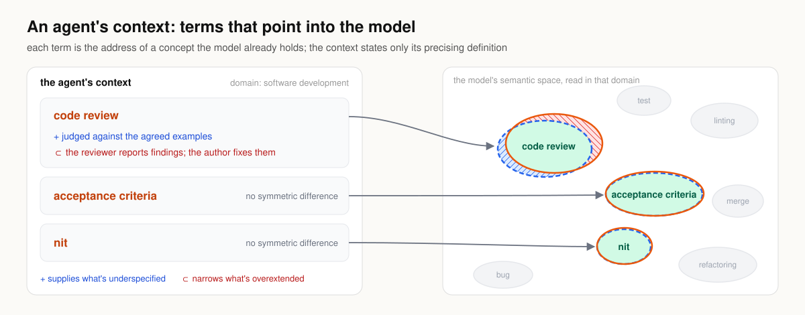
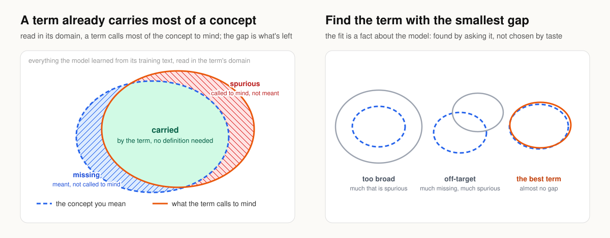
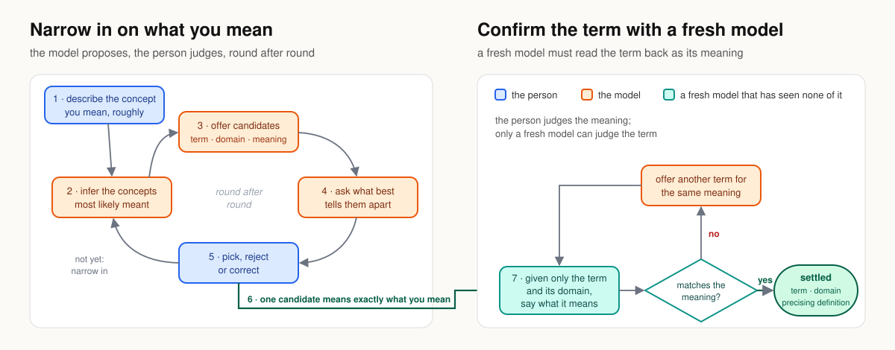

# Cratylic Context Design

_Expressing client intent in terms the model naturally understands._

A foundation model's semantic space is its _universe of discourse_. Within that universe, the label that most precisely evokes a concept is its _Cratylic name_.

Conventionally, authors express intent in freeform prose, leaving the model to infer concepts it already knows by name. This invites ambiguity, semantic drift, and conceptual divergence.

**Cratylic Context Design** inverts this convention.

**The pattern:** Express each concept using the name the model already associates with its meaning in the target domain, then add only the minimal corrections needed to resolve missing or extraneous semantics.

Each term works like an address: it points to a concept the model already represents, so the context need only carry the correction. _Code review_ needs two corrections. _Acceptance criteria_ and _nit_ need none.

## Why it works

In context, a term evokes most of its concept. What remains is a semantic gap: **missing** meaning to supply and **spurious** meaning to exclude. Spurious meaning is especially dangerous because it silently distorts intent. The best term leaves the smallest gap. Because that gap is model-dependent, intuition proposes; model evaluation confirms.

## Finding the term

You know the concept, and the model knows the terms. It proposes, you judge, until a candidate best matches your intent. Then a fresh model, given only the term and its domain, must say what it means. Whatever its reading leaves missing or makes spurious goes into the correction. Only you can confirm the intended meaning; only a cold read can independently reveal the model's interpretation.

## Properties

- **Shorter contexts:** the term carries the concept.
- **The risky part is explicit:** spurious expectations are ruled out by name.
- **Testable:** a cold read isolates what the term conveys before correction.
- **Localized corrections:** each correction lives once, beside its term.
- **Broadly portable:** common concepts tend to retain their meaning across models. Verify when precision matters or interpretations diverge.
