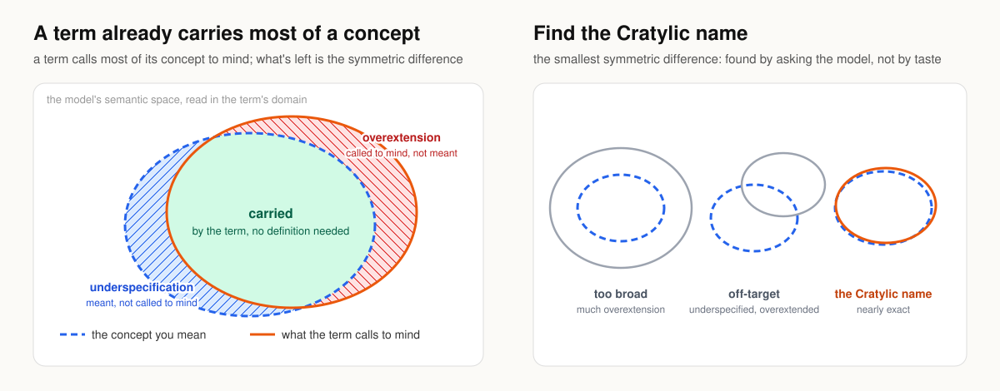

# Cratylic Context Design

_Expressing client intent in terms the model naturally understands._

Within a foundation model's _semantic space_, the term that most precisely evokes a concept is its _Cratylic name_.

Conventionally, authors express intent in freeform prose, leaving the model to infer concepts it already knows by name. This invites ambiguity, semantic drift, and conceptual divergence.

**Cratylic Context Design** inverts this convention.

**The pattern:** Express each concept using the name the model already associates with its meaning in the target domain, then add a _precising definition_ for the symmetric difference that remains.

Each term works like an address: it points to a concept the model already represents, so the context need only carry the precising definition. _Code review_ needs two clauses. _Acceptance criteria_ and _nit_ need none.

## Why it works

In context, a term evokes most of its concept. What remains is the _symmetric difference_: **underspecification**, meant but not evoked, and **overextension**, evoked but not meant. Overextension is especially dangerous because it silently distorts intent. The best term leaves the smallest symmetric difference. Because that difference is model-dependent, intuition proposes; model evaluation confirms.

## Finding the term

You know the concept, and the model knows the terms. It proposes, you judge, until a candidate best matches your intent. Then a fresh model, given only the term and its domain, must say what it means. Wherever its reading underspecifies or overextends the concept, the precising definition states what holds. Only you can confirm the intended meaning; only a fresh reading can independently reveal the model's interpretation.

## Properties

- **Shorter contexts:** the term carries the concept.
- **The risky part is explicit:** the precising definition narrows each overextension.
- **Testable:** a fresh reading isolates what the term conveys on its own.
- **Localized definitions:** each precising definition lives once, beside its term.
- **Broadly portable:** common concepts tend to retain their meaning across models. Verify when precision matters or interpretations diverge.
