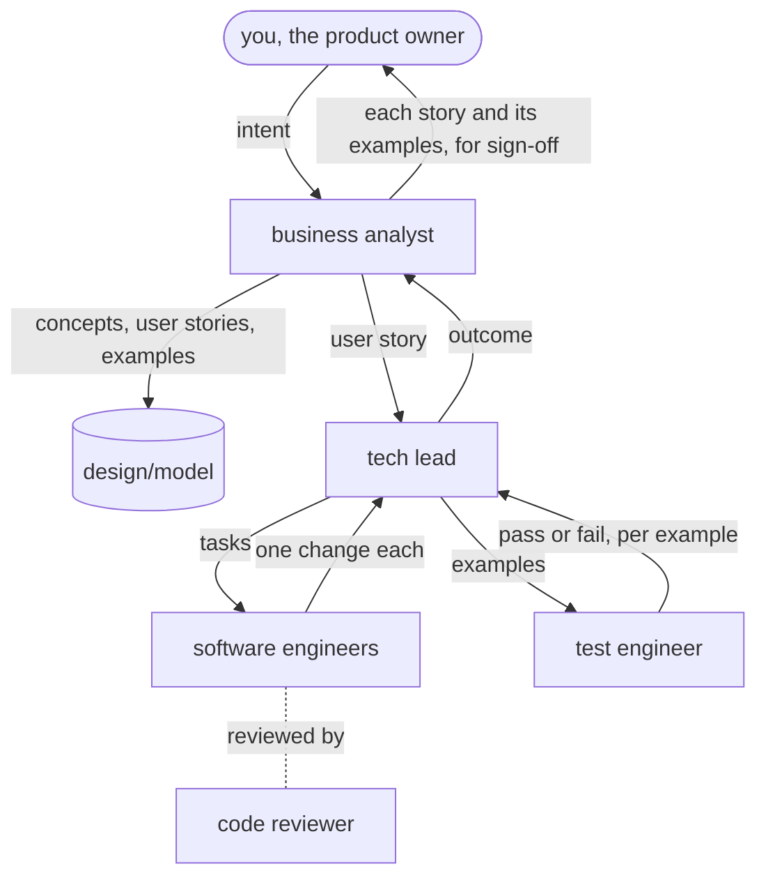
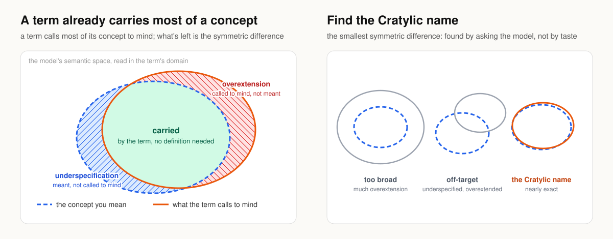
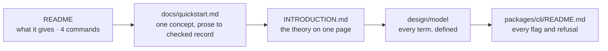

# Cratylus

[](https://github.com/leclabs/cratylus/actions/workflows/verify.yml)
[](https://www.npmjs.com/package/cratylus)
[](./packages/cli/package.json)
[](./LICENSE)

**Stop re-explaining your requirements to your AI coding agent.**

If you work with one, you know the drill. You explain the same requirement again every session. It builds something close to what you meant, but not quite it. And your long prompt files still leave it room to guess.

Here's what cratylus gives you instead:

- **What you mean, written down once.** A business analyst agent records your concepts, user stories and examples as plain files in your repo, and the team works from them. Your colleagues can read and review those files too.
- **A whole team, with no prompts to write.** One command installs a business analyst, a tech lead, software engineers, a test engineer and a code reviewer into omp.
- **Nothing gets built on a guess.** By default you sign off each user story and its examples before the build starts. Each example is bound to an acceptance test, and `cratylus model check` fails when one isn't.
- **A second pair of eyes from another model.** Where another model family is available, it runs the tests and the review, rather than the family that wrote the code.
- **Easy to try, easy to remove.** Everything lives in one folder, and `cratylus uninstall --harness omp` takes it away.

**Cratylus gives your coding agent a team: a business analyst, a tech lead, software engineers, a test engineer and a code reviewer. They keep what you mean in a domain model and build it with behaviour-driven development.**

You talk to one agent, the business analyst. It writes each concept you mention into plain files under `design/model`. It agrees user stories and their examples with you, then hands the build to the rest of the team. You don't write any agent prompts yourself.



This is the usual flow, as each agent's own definition describes it. It isn't a fixed pipeline: any agent can call any other. At the end, the business analyst checks that what was built means what you intended.

## Why it's built this way

Most agent instructions are freeform prose. The catch is that the model already knows most of what you're describing under some name, and prose leaves it guessing which one. Cratylus does the opposite. Every agent it installs calls each concept by the term the model already associates with it, its _Cratylic name_. A short _precising definition_ then covers only the gap: what the term misses, and what it drags in that you don't mean.



Here's an example from this repository. First, a rule written as prose:

> Before a change merges, a single command builds, lints, typechecks and runs the deterministic tests; developers run that same command locally (a pre-push hook runs it) and CI runs exactly it, nothing more.

Then the same rule as a term plus its precising definition:

> **the pre-merge check**: the single command that builds, lints, typechecks and runs the deterministic tests. A pre-push hook runs it locally, and CI runs exactly it and nothing more. Passing it is what a change needs to merge.

The two are about the same length, and that's fine: you write the definition once, and everywhere else the agents just say _the pre-merge check_. The definition isn't a guess, either. It's written against what a fresh model actually said the bare term means. That reading assumed a CI-only bundle of jobs, possibly including security scans and review approvals, and it left out the local run. The definition supplies the local run and rules out the extras. You'll reproduce this in the [quickstart](./docs/quickstart.md).

What that gets you (from [INTRODUCTION.md](./INTRODUCTION.md), the one-page theory):

- **Shorter context:** the term carries most of the meaning.
- **The risky part is written down:** the definition names exactly where the term would mislead.
- **You can test it:** ask a fresh model what a term means and compare its answer with your definition.
- **One place per definition:** it lives once, in `design/model`, next to its term.

## Get started (about five minutes)

You need Node 22 or later.

**1. Install omp** by following [omp's installation guide](https://github.com/can1357/oh-my-pi#install), set up a model provider there, and run omp once. omp is the coding-agent harness the team runs in, and cratylus installs into the `~/.omp` it creates.

**2. Install cratylus.**

```sh
npm install -g cratylus
```

**3. Install the team.**

```sh
cratylus install --dry-run   # preview: what it would place, and where; writes nothing
cratylus install
```

Install asks only what you haven't told it: which harness, which rulesets your agents follow in every project, and which model each tier runs on. Agents fall back to two tiers:

- `frontier` runs the business analyst, the tech lead and the software engineers.
- `frontier-other-family` runs the test engineer and the code reviewer. Bind it to a model of another family than `frontier`'s, so a different family checks the work than the one that wrote it.

The bindings go into your own omp settings, so upgrading or uninstalling keeps them. Everything cratylus places goes into one folder it owns, `~/.cratylus/omp/`, and omp loads it in every project.

**4. Start with the business analyst** and tell it what you want:

```sh
omp --agent business-analyst
```

If you forget how to start, run `cratylus` with no arguments. `cratylus --help` lists everything else.

### Where to go next

Go one level deeper only when you need to:



## Day to day

- **One project only:** run `cratylus install --scope project` inside it. The folder is then `<project>/.cratylus/omp/`, and in that project omp loads it instead of yours. Commit `.cratylus/omp` and `.omp/` to share it with your team. Upgrade and uninstall it from that project with the same `--scope project`.
- **Upgrade:** run `npm install -g cratylus`, then `cratylus install` again. The folder is replaced whole. Until you do, every omp session start warns you that the installed agents and the command don't match.
- **Uninstall:** run `cratylus uninstall --harness omp`. It removes cratylus's folder and every reference into it, and leaves whatever omp itself placed or changed.

Every flag, refusal and default is in [packages/cli/README.md](./packages/cli/README.md).

## Contributing

Read [INTRODUCTION.md](./INTRODUCTION.md) first, then the domain model in [design/model](./design/model). Each concept is one plain file, each bounded context is a directory, and git is its history. Every example in the model must be bound to an acceptance test titled `<context>/<concept>: <example name>`, and `cratylus model check` enforces that. [AGENTS.md](./AGENTS.md) has the working conventions.

The workspace pins its Node and pnpm versions in the root [package.json](./package.json)'s `devEngines` and refuses any others. With [mise](https://mise.jdx.dev), run `mise trust && mise install`, then `pnpm install` and `pnpm check`, the same check CI and the pre-push hook run.

## License

MIT. See [LICENSE](./LICENSE).
