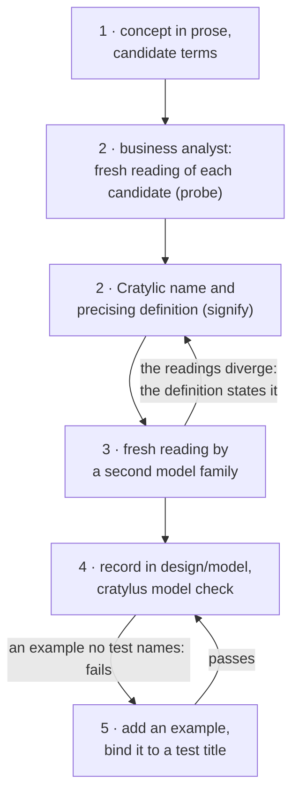

# Quickstart: give a concept its Cratylic name

In this walkthrough you'll take one concept from a sentence of prose to a checked record in a domain model. On the way you'll find the term the model already uses for it, which is its _Cratylic name_, and check that term with a _fresh reading_: a model given only the term and its domain, with no other context.

Everything below comes from a real run on 2026-11-05 with cratylus 0.21.1 and omp 18.16.0. Your output will differ in wording, because models vary from run to run. Long answers are shortened where you see `…`.

It assumes you've done the four steps in the [README](../README.md#get-started-about-five-minutes).



## 1. Say what you mean, in prose

Start with what you mean, in your own words. Don't polish it. We'll use the check this repository runs on every change:

> Before a change merges, a single command builds, lints, typechecks and runs the deterministic tests; developers run that same command locally (a pre-push hook runs it) and CI runs exactly it, nothing more.

Then jot down the names you'd naturally reach for. Here they are `quality gate`, `required status check` and `pre-merge check`.

## 2. Ask the business analyst to test the candidates

The business analyst has two skills for this:

- `probe` finds out what a term actually brings to a model's mind.
- `signify` picks the winner and writes its precising definition.

You don't call them yourself. Just ask in plain words:

```sh
omp --agent business-analyst
```

> I want our agents to name one concept by its Cratylic name. Domain: software delivery. The concept: before a change merges, a single command builds, lints, typechecks and runs the deterministic tests; developers run that same command locally (a pre-push hook runs it) and CI runs exactly it, nothing more. Candidates I am considering: "quality gate", "required status check", "pre-merge check". Probe each candidate with a fresh reading, choose the Cratylic name, and give its precising definition. Report only; do not create or edit any files.

In our run the agent read both skills, then made each fresh reading as a separate model call that carried no project context. It asked each question two ways: once openly, and once allowing the model to answer "no term fits", so the model wasn't pushed into producing an answer.

For each candidate, here is what the reading added that you don't mean, and what it left out that you do:

| Candidate               | Adds (evoked, not meant)                                                                                    | Lacks (meant, not evoked)                               | Verdict                                                                     |
| ----------------------- | ----------------------------------------------------------------------------------------------------------- | ------------------------------------------------------- | --------------------------------------------------------------------------- |
| `quality gate`          | SonarQube-style metric thresholds; gates at any pipeline stage; manual sign-offs; security/compliance scans | the merge as its anchor; the one command; the local run | worst: its core meaning contradicts the concept                             |
| `required status check` | a platform branch-protection setting; many external checks; server-side only                                | all the content                                         | names a different concept: the platform rule that makes the check mandatory |
| `pre-merge check`       | plural checks; review approvals; possibly non-deterministic tests; runs in CI only                          | the one command; the local run; "CI runs exactly it"    | smallest difference; what it adds is extra breadth, not a contradiction     |

What it settled on, verbatim:

> I chose **"pre-merge check"**, used in the singular with "the": _the pre-merge check_. …
>
> **the pre-merge check**: the single command that builds, lints, typechecks and runs the deterministic tests. A pre-push hook runs it locally, and CI runs exactly it and nothing more. Passing it is what a change needs to merge.

Read the definition as a list of patches. Each clause fixes one gap:

- **It adds what the term misses:** one command, what that command contains, the local run, and CI running exactly that command.
- **It rules out what the term drags in:** an open-ended, CI-only set of checks that may include review approvals, scanners, coverage thresholds or flaky tests.
- **It uses the singular, _the_ pre-merge check:** that blocks the default plural reading, "any collection of checks".

Notice the losers. `required status check` wasn't wrong: it names a neighbouring concept, the branch-protection setting that makes your check mandatory. If you ever need that concept, its name is already taken care of.

The analyst also tested its own ranking. It asked with the candidates in three different orders, and the ranking never changed. Asked with no candidates at all, the model said no established term names the concept exactly. That's normal, and it's why the definition is there.

One limit it reported itself: every reading came from one model, because omp's `smol` and `slow` roles weren't set up. So check the result from another angle.

## 3. Check the name with a second model family

A fresh reading doesn't need any special tooling. It's a model given the term and its domain, and nothing else. You can do it with plain omp, switching off everything that could leak context in: tools, skills, extensions, rules, context files and the saved session. Pick a model from another family:

```sh
omp -p --no-session --no-tools --no-skills --no-extensions --no-rules --no-context-files \
  --model <a model of another family> \
  'Domain: software delivery. In this domain, what does the term "pre-merge check" mean? Answer in at most 6 terse bullets: what it is, where it runs, what it contains, what it does not imply.'
```

```text
- **What it is:** Validation of a proposed change before merging it into a target branch.
- **Where it runs:** Locally or in CI, commonly triggered by a pull/merge request or run against a candidate merge commit.
- **What it contains:** Configured checks such as builds, tests, linting, type checks, security scans, and policy checks.
- **What it does not imply:** Passing is not proof of correctness, human approval, a completed merge, or successful deployment; blocking the merge requires an enforced gate.
```

Compare it with the first reading:

- **Same core:** validation before merging, containing builds, tests, linting and type checks.
- **Same extras:** it drags in security scans and policy checks. The definition's "nothing more" already rules those out.
- **One difference:** it says the check runs "locally or in CI", where the first model said CI only.

That difference is the lesson. Where a term's reading depends on the model, don't leave it to the term: state it in the definition. Ours already names both places, so it holds for both readers.

## 4. Write it down in the domain model

A domain model is plain files. Each concept gets one file, `design/model/<context>/<concept>.md`. Its first line is `# <Cratylic name>`, and the precising definition follows. Concepts are grouped by _bounded context_, the area in which a term has one meaning. Each context directory has a `context.md`, and a `purpose.md` sits at the top:

```text
design/model/
  purpose.md
  delivery/
    context.md                 # "# delivery", then **Subject:** … and **Relation:** …
    pre-merge-check.md
```

`design/model/delivery/pre-merge-check.md`:

```md
# pre-merge check

The single command that builds, lints, typechecks and runs the deterministic tests. A pre-push hook runs it locally, and CI runs exactly it and nothing more. Passing it is what a change needs to merge.
```

Now ask cratylus to check the model's shape:

```sh
cratylus model check
```

```json
{
  "model": "…/design/model",
  "passed": true,
  "failures": []
}
```

## 5. Add an example, and bind it to a test

A definition says what a term means. An example shows it happening, written as Given / When / Then. Add one to the concept file:

```md
## Examples

### a red check blocks the merge

Given a change whose typecheck fails
When the pre-merge check runs
Then it fails and the change does not merge
```

Run the check again. It fails, with exit code 1, because no test claims this example yet:

```json
{
  "model": "…/design/model",
  "passed": false,
  "failures": [
    {
      "concept": "delivery/pre-merge-check",
      "example": "a red check blocks the merge",
      "message": "delivery/pre-merge-check: example \"a red check blocks the merge\" has no acceptance test naming it and is not judged in review"
    }
  ]
}
```

To bind it, write an acceptance test, an `it(…)` or `test(…)` call, whose title is exactly `<context>/<concept>: <example name>`. The check then passes again:

```ts
it('delivery/pre-merge-check: a red check blocks the merge', () => {
  // …
});
```

One thing to be clear on: the model check matches examples to tests **by title only**. It never runs the test. An empty test body satisfies it, so the real proof is your test runner going green.

## Where to go next

- [INTRODUCTION.md](../INTRODUCTION.md): the theory behind all this, on one page.
- [design/model/context-engineering](../design/model/context-engineering): how this repository defines its own terms, including _Cratylic name_.
- [packages/cli/README.md](../packages/cli/README.md): every command, flag and refusal.
